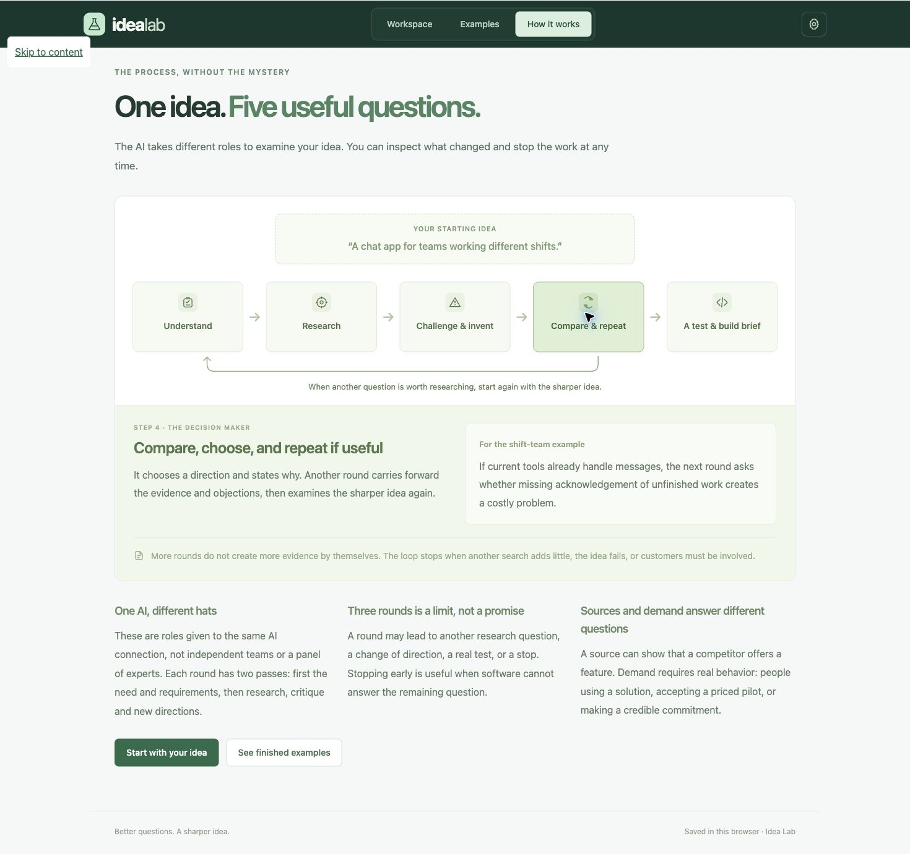
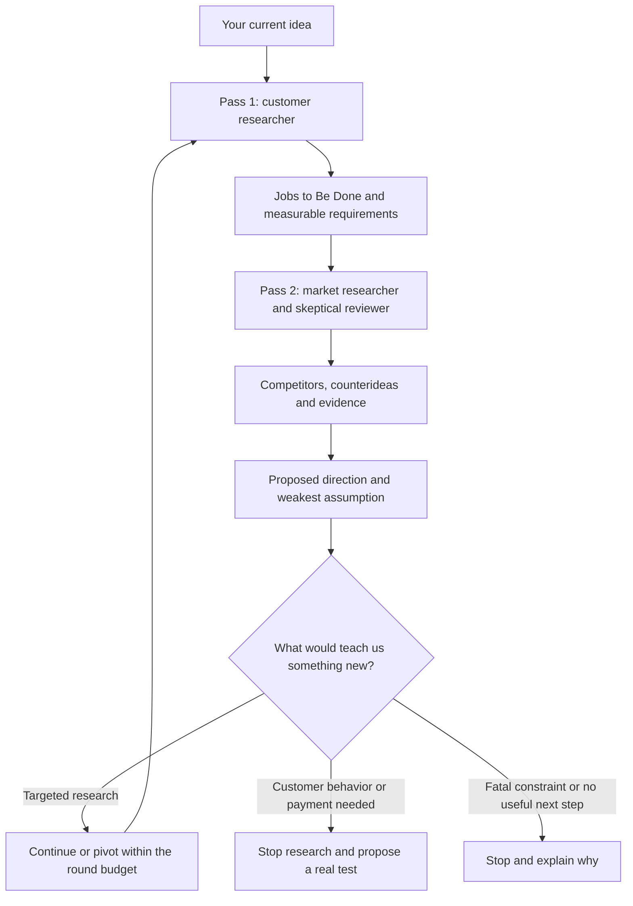

# Idea Lab

Turn a software idea into a sharper business hypothesis. Idea Lab investigates the customer’s job, compares alternatives, challenges the idea and narrows it into something you can test. Everything is in English, with three main tabs: **Workspace**, **Examples** and **How it works**.



- Set a budget of two to five research rounds, with explicit test and stop decisions.
- Connect Jobs to Be Done, measurable requirements, competitors, counterideas and an evidence ledger.
- Learn from three worked examples featuring Uber Eats, Slack / Microsoft Teams and Calendly.
- Choose an API or eligible subscription CLI, keep research locally and export an MVP implementation prompt.

## Quick start

Clone or download this repository. With Node.js 22 or newer installed, open the project folder and start the app:

```sh
git clone https://github.com/marcoscobo/idea-lab.git
cd idea-lab
npm start
```

Open [http://localhost:3000](http://localhost:3000). The app has no npm dependencies. You can explore the worked examples immediately.

## Set up your AI in Settings

Open **Settings** and choose a provider.

- **OpenAI API:** enter your API key in the dedicated settings form and save it. Use the connection check to verify access without running a paid analysis. Research uses API billing; a ChatGPT subscription does not pay these API charges.
- **Codex / ChatGPT subscription:** use an existing eligible ChatGPT login in the official Codex CLI installed alongside the server.
- **Claude subscription:** use an existing eligible subscription login in the official Claude Code CLI installed alongside the server.

An installed CLI still needs a valid subscription login, available model access and quota. The app checks the reported login method when research starts. It does not silently switch a subscription provider to API billing.

Saved API credentials stay on the app server in `.data/settings.json`, with a private directory and owner-only file permissions. They are sent directly from Settings to the server, never saved in browser storage, returned in saved settings or included in research exports. A blank key field keeps the current key; the explicit remove action clears it and disables environment-key fallback. Restarting the app preserves saved settings. Keep the app local to your computer.

The connection check verifies authentication only. It does not promise that a particular model or research request will complete. Provider usage, plan limits and account permissions still apply.

## Use the Workspace

1. Describe the software idea, intended customer, market and what you want to learn.
2. Choose a research budget of two to five rounds and start.
3. Review the conclusion and its reasoning. Open the detailed JTBD, requirements, competition, counterideas and evidence when useful.
4. Add observations from real customers or experiments before continuing. Their scope and uncertainty remain visible.
5. Generate an MVP implementation prompt when there is a useful test to build.

The latest **12 investigation groups**, including their completed rounds, are saved in this browser. Export JSON for a separate backup and import it to resume elsewhere. Browser profiles do not synchronize. Cancelling a run preserves finished rounds and requests cancellation of the active call; provider usage already consumed remains consumed. Keep the local app open during an automatic run.

## What the AI does

One selected AI provider performs two passes in each round, taking different research roles:



The app carries the selected refinement, contrary evidence, source limits and your observations into the next round. The round budget is a maximum: the AI should stop earlier when another model response cannot resolve the decisive question. At the budget boundary, the result should identify a test or a reason to stop.

A clever niche, few search results or repeated AI agreement does not establish demand. No loop can invent interviews, transactions or pilot results. Proposed success thresholds are experiment plans, not achieved results.

For the API path, source URLs are checked against URLs returned by native web search. Subscription CLI sources are labeled **provider-reported**; the app does not independently verify the CLI’s search transcript or whether every page supports every claim. A documented competitor capability can be a fact while demand for your concept remains a hypothesis.

## Learn from the Examples

Each case shows the broad starting idea, what existing products already do, the narrower business mechanism, who might pay, the biggest risk and a test that could kill the proposal. Open the full three-round analysis to inspect the details and sources, or use its suggested idea as a starting point.

- **Competing with Uber Eats:** move from another delivery app to a fixed weekly lunch-coordination service for three nearby offices. Compare configured group ordering and standing catering before assuming a gap.
- **Competing with Slack / Microsoft Teams:** move from another messenger to one shift-handover receipt, while keeping existing communication tools. Compare it with a shared checklist and require worker agreement.
- **Competing with Calendly:** move from paid booking links to preparation readiness for paid CV reviews. Keep the existing calendar and payment processor, and measure client friction alongside saved consultant time.

These are **curated worked examples with unvalidated demand**. They were authored as completed analysis walkthroughs; no customer interviews or pilots were performed. Product capabilities were checked on November 19, 2026 using [Uber Help](https://help.uber.com/en-GB/ubereats/restaurants/article/how-to-place-a-group-order?nodeId=886fdace-3cee-4658-9d3c-7cadfbec5280), [DoorDash Help](https://help.doordash.com/en-us/business/article/guide-to-group-orders), [Slack Help](https://slack.com/help/articles/203950418-Use-a-canvas-in-Slack), [Microsoft Support](https://support.microsoft.com/en-us/teams/shifts/schedule-staff-shifts), [Calendly Help](https://calendly.com/help/payments-faq) and [Google Calendar Help](https://support.google.com/calendar/answer/13762729?hl=en). Features and account eligibility can change.

## The MVP handoff

Generate, copy or download an implementation prompt from the chosen analysis. It includes the target customer, selected scope, linked JTBD and requirements, acceptance metrics, objections, validation experiment, credential handling, one-container setup and checks to run. A STOP decision gates building the rejected business.

Generating the prompt does not execute it, build the MVP or deploy anything. Paste it into your preferred coding assistant when you are ready to implement the proposed test.

## Optional: subscription CLI setup

Install the official CLI in the same environment that runs the server and sign in there. The native CLI manages its own login; Idea Lab does not extract browser cookies or copy host tokens.

```sh
codex login
codex login status
```

ChatGPT sign-in provides eligible subscription access. See [OpenAI authentication](https://learn.chatgpt.com/docs/auth) and the [Codex CLI reference](https://learn.chatgpt.com/docs/cli/reference).

```sh
claude auth login
claude auth status --json
```

Claude Code supports eligible Pro, Max and Ultra subscriptions. See [Claude subscription setup](https://support.claude.com/en/articles/11145838-use-claude-code-with-your-pro-max-or-ultra-plan) and [programmatic Claude Code usage](https://code.claude.com/docs/en/headless).

Subscription subprocesses omit inherited API keys and token variables and require the official CLI to report a subscription login. Update the CLI if it rejects a safety or structured-output flag. Optional `CODEX_BIN`, `CLAUDE_BIN` and model settings are described in `.env.example`.

## Optional: run in one Docker container

Docker must be running. The image includes the UI, server and both official CLIs. Use dedicated named volumes for app settings and native CLI logins:

```sh
cd idea-lab
docker build -t idea-lab .
docker run --rm --name idea-lab -p 127.0.0.1:3000:3000 --mount type=volume,source=idea-lab-settings,target=/app/.data --mount type=volume,source=idea-lab-cli,target=/home/node idea-lab
```

Open the same local address and configure the API key through Settings. For a subscription provider, authenticate inside the running container using the supported provider flow:

```sh
docker exec -it idea-lab codex login --device-auth
docker exec -it idea-lab claude auth login
```

Follow the displayed browser instructions. Device login depends on account support. Keep these volumes private; they persist after the container is removed. Do not mount your host home directory or copy its credential files into the image. The app runs as a non-root user and includes a health check. To stop it, interrupt it or run `docker stop idea-lab`.

For a different server settings directory, configure `IDEA_LAB_DATA_DIR`. An optional `OPENAI_API_KEY` environment value is used when no saved choice overrides it. Settings can explicitly remove that fallback. To use environment configuration locally, copy `.env.example` to `.env` and restart; never include credentials in the image or source control.

## Verification and project files

```sh
npm test
```

Tests cover server and settings boundaries, mocked provider research, subscription preflight, credential isolation, process cancellation, evidence provenance, bounded iteration context, MVP prompt requirements and all nine example rounds. Test runs make no real model calls or quota charges. A live provider smoke check and a Docker build are separate checks; an installed CLI alone does not prove inference works.

```text
public/       English UI, workflow helpers, demo and curated examples
lib/          Analysis contracts, prompts and provider adapters
.data/        Private server settings, excluded from source and image
test/         Server, settings, provider and workflow tests
server.mjs    HTTP server and provider orchestration
Dockerfile    One-container runtime
.env.example  Configuration without credentials
```
